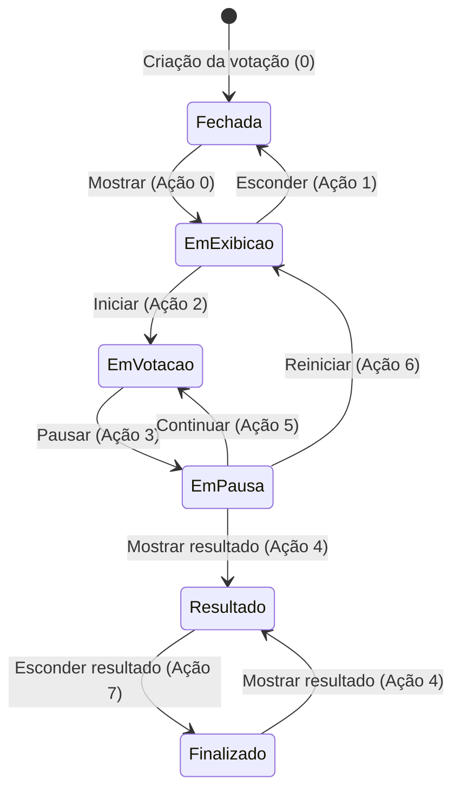

[README](../README.md) |
[Descrição funcional](descricao_funcional.md) | 
Descrição técnica

---

# Descrição Técnica — Votação Rápida

Este documento descreve a arquitetura técnica, os subsistemas, os padrões de comunicação e as decisões de implementação do **Votação Rápida** (`uspdev/votacao`).

---

## 1. Visão Arquitetural

A aplicação adota uma arquitetura desacoplada em duas camadas principais hospedadas no mesmo repositório:

1. **API Interna REST (`/public/api`):**
   * Ponto de entrada: `public/api/index.php`.
   * Construída sobre o pacote `uspdev/webservice` e o microframework `FlightPHP`.
   * Protegida por **HTTP Basic Auth** (`API_USER` e `API_PWD` definidos no `.env`).
   * Responsável por toda a regra de negócio, máquina de estados das votações, persistência no banco de dados e envio/registro de e-mails e logs.

2. **Front-end Web (`/public/index.php`):**
   * Ponto de entrada: `public/index.php`.
   * Gerencia as rotas web, sessões de navegação e autenticação de usuários via **OAuth Senha Única USP** (`uspdev/senhaunica`).
   * Comunica-se com a API interna por meio de chamadas HTTP cURL gerenciadas pela classe `src/View/Api.php`.
   * Renderiza os templates HTML com o motor `raelgc/template`.

```
┌─────────────────────────────────────────────────────────────────┐
│                        Navegador / Cliente                      │
└───────────────┬─────────────────────────────────┬───────────────┘
                │ HTTP (OAuth USP / HTML)          │ HTTP (Status Polling)
                ▼                                 ▼
┌─────────────────────────────────────────────────────────────────┐
│                    Front-end Web (/public)                      │
│                  FlightPHP + raelgc/template                    │
│                                                                 │
│   src/View/ (Admin, Gerente, Run, Api)                          │
└───────────────────────────────┬─────────────────────────────────┘
                                │ cURL + Basic Auth (127.0.0.1)
                                ▼
┌─────────────────────────────────────────────────────────────────┐
│                    API Interna (/public/api)                    │
│                  uspdev/webservice + FlightPHP                  │
│                                                                 │
│   src/Controller/ (Admin, Gerente, Run)                         │
└───────────────────────────────┬─────────────────────────────────┘
                                │ RedBeanPHP 5.7
                                ▼
┌─────────────────────────────────────────────────────────────────┐
│                  Banco de Dados (MySQL / SQLite)                │
└─────────────────────────────────────────────────────────────────┘
```

---

## 2. Pilha Tecnológica e Dependências

| Componente | Biblioteca / Pacote | Versão / Padrão | Finalidade |
| :--- | :--- | :--- | :--- |
| **Linguagem / Runtime** | PHP | `>= 8.2` (testado em 8.2 e 8.3) | Backend principal |
| **Roteamento Web & API**| `flightphp/core` | `^3.0` | Microframework de rotas e injeção |
| **Serviço de API** | `uspdev/webservice` | `1.*` | Tratamento de requisições e Basic Auth |
| **ORM / Persistência** | `gabordemooij/redbean` | `^5.7` | Mapeamento objeto-relacional sem schema rígido |
| **Motor de Templates** | `raelgc/template` | `^2.2` | Renderização de views HTML |
| **Autenticação USP** | `uspdev/senhaunica` | `^2.0` | OAuth 1.0a Senha Única USP |
| **Envio de E-mails** | `phpmailer/phpmailer` | `^6.1` | SMTP autenticado / OAuth Google / fallback de log |
| **Logging de Auditoria**| `monolog/monolog` | `^2.0` | Logs rotativos estruturados em JSON |
| **Frontend UI** | Bootstrap | `4.6` | Framework CSS responsivo |
| **Tabelas Dinâmicas** | Bootstrap Table | `1.16` | Paginação server-side, busca e filtros |
| **Ícones** | Font Awesome Free | `5.*` | Ícones vetoriais |
| **Biblioteca JS** | jQuery | `3.5` | Manipulação do DOM e AJAX |

---

## 3. Estrutura do Código-fonte

* **`config/app.php`:** Centraliza a leitura do `.env`, define os valores padrão para todas as variáveis de ambiente e disponibiliza o helper global `config('chave')` e retorno em array.
* **`app/bootstrap.php`:** Centraliza a inicialização do ambiente, inclusão de `config/app.php`, configuração do timezone (`America/Sao_Paulo`), conexão com o banco de dados via RedBeanPHP, supressão de `E_DEPRECATED` e ativação de buffers de saída.
* **`src/Model/`:**
  * `Email.php`: Gestão da fila de mensagens, envio via PHPMailer ou registro em log, disparos em background.
  * `Log.php`: Wrapper para Monolog com canais específicos (`db`, `email`, `votacao`, `gerente`, `admin`).
  * `Sessao.php`: Regras de criação, configuração e ciclo de sessões de votação.
  * `Votacao.php`: Totalização de votos, opções, exportação de apuração e relatórios em JSON.
  * `Token.php`: Geração de tokens abertos/fechados, tickets de acesso e impressão de cédulas.
  * `Usuario.php`: Gestão de permissões de administradores e gerentes.
* **`src/Controller/` (API):**
  * `Admin.php`: Operações administrativas globais (sessões, gerentes, logs e visualização de e-mails).
  * `Gerente.php`: CRUD de sessões, votações, alternativas, eleitores e tokens.
  * `Run.php`: Processamento de votos, transições de estado da votação e controle do painel de apoio.
* **`src/View/` (Front-end Web):**
  * `Admin.php`, `Gerente.php`, `Run.php`: Controladores de tela e montagem dos templates.
  * `Api.php`: Camada cliente cURL com resolução de DNS local (`CURLOPT_RESOLVE`), autenticação Basic e tratamento amigável de erros em ambiente de desenvolvimento.

---

## 4. Máquina de Estados e Ciclo de Vida da Votação

Cada votação percorre um ciclo finito e controlado de estados, definidos nas tabelas `estado` e `acao`:



### Tabela de Estados (`estado`)
| Código | Nome do Estado | Ações Disponíveis | Descrição |
| :---: | :--- | :--- | :--- |
| `0` | **Fechada** | `0` (Mostrar), `10` (Excluir) | Votação cadastrada, mas fora da tela do telão. |
| `1` | **Em exibição** | `1` (Esconder), `2` (Iniciar) | Título e alternativas projetados no telão (`/painel`). |
| `2` | **Em votação** | `3` (Pausar) | Urna aberta; eleitores podem submeter votos. |
| `3` | **Em pausa** | `4` (Mostrar resultado), `5` (Continuar), `6` (Reiniciar) | Votação suspensa momentaneamente para conferência da mesa. |
| `4` | **Resultado** | `7` (Esconder resultado) | Apuração e gráficos exibidos no telão; pleito aguardando conclusão. |
| `5` | **Finalizado** | `4` (Mostrar resultado) | Votação encerrada e arquivada; pode ser reexibida se necessário. |

### Regras Críticas de Concorrência e Bloqueio:
* **Trava de Votação Ativa:** Enquanto houver uma votação em estado `Em votação` (2), `Em pausa` (3) ou `Resultado` (4):
  * No painel de apoio (`/apoio`): os botões de todas as outras votações e o botão de *"Criar votação instantânea"* ficam **desabilitados visualmente**.
  * No backend (`Run::apoioPost`): requisições concorrentes ou diretas para alterar outras votações são **rejeitadas com erro**, impedindo que operadores em dispositivos paralelos interfiram no pleito em andamento.

---

## 5. Telas de Execução e Sincronização em Tempo Real

A execução de uma sessão envolve três interfaces complementares:

### 5.1. Painel de Apoio da Mesa (`/apoio`)
* Interface utilizada pelos operadores e secretários da reunião para conduzir o pleito.
* **Sincronização Multi-dispositivo:** Para permitir que múltiplos membros da mesa operem a sessão simultaneamente, a página consulta periodicamente o endpoint leve `GET /apoio/status` (polling a cada 2,5 segundos).
* O endpoint retorna um hash MD5 representativo do estado atual das votações. Caso ocorra uma alteração feita por outro operador, o painel recarrega suavemente os novos estados.
* **Proteção contra Sobrescrita:** O auto-recarregamento é automaticamente congelado enquanto o operador estiver digitando no campo de criação de votação instantânea.

### 5.2. Telão de Exibição da Assembleia (`/painel`)
* Interface projetada em telões, TVs ou transmitida via Google Meet / Zoom.
* **Eliminação de Flickering:** Não utiliza a tag legada `<meta http-equiv="Refresh">`.
* Utiliza verificação assíncrona contra o endpoint leve `GET /painel/status` (polling a cada 2 segundos), recarregando o DOM apenas quando há alteração real de estado, entrada de novos votos ou exibição de resultados.

### 5.3. Tela do Eleitor (`/votacao`)
* Acessada pelos votantes por meio de link com token recebido por e-mail ou leitura de QR Code.
* Permite submissão anônima (voto fechado) ou nominal (voto aberto), registrando na tabela `resposta` com controle de unicidade por `last = 1`.

---

## 6. Subsistema de E-mails e Processamento Assíncrono

1. **Estrutura da Fila:**
   * Mensagens geradas são serializadas e gravadas na tabela `email` com status inicial `enviar = 1` e `status = NULL`.
2. **Modos de Operação (`EMAIL_AUTH_TYPE`):**
   * **Modo Log (`EMAIL_AUTH_TYPE='log'` ou sem SMTP):** Simulação imediata; grava o corpo das mensagens em `local/log/emails_YYYY-MM.log` e salva o status no banco como `YYYY-MM-DD HH:MM:SS (log)`.
   * **Modo SMTP / TLS / SSL / OAuth:** Conecta ao servidor de e-mail (ex: Google Workspace / Gmail institucional) via PHPMailer.
3. **Processamento em Background:**
   * O método `Email::dispararProcessamentoFila()` detecta o binário CLI correto (`Email::getPhpCli()`), evitando erros ao rodar sob PHP-FPM, e dispara o worker `cli/processarEmailsFila.php`.
   * O worker utiliza **trava exclusiva não-bloqueante** (`flock` em `local/log/email_queue.lock`), garantindo que execuções concorrentes via web ou Cron Job terminem instantaneamente sem duplicar disparos de e-mail.
4. **Paginação Server-Side no Admin (`/admin/email`):**
   * Consultas com paginação assíncrona (`data-side-pagination="server"`) e cláusulas `LIMIT`/`OFFSET` via RedBeanPHP, suportando com facilidade bases com dezenas de milhares de mensagens sem estouro de memória (`memory_limit`).

---

## 7. Banco de Dados e Migrations

O sistema utiliza **RedBeanPHP** com tabelas essenciais: `usuario`, `sessao`, `votacao`, `alternativa`, `token`, `resposta`, `email`, `estado`, `acao`, `log` e `migration`.

### 7.1. Provisionamento Inicial (Banco Vazio)
```bash
php sql/provisionar.php
```
Executa a migration inicial de tabelas (`sql/1_migration_inicial.php`), aplica os dados de seed básicos (`sql/2_seed_inicial.php`) e aciona o runner de migrations incrementais.

### 7.2. Runner Incremental de Migrations
```bash
php sql/atualizar.php
```
* Cria a tabela `migration` caso ainda não exista (`id`, `nome`, `aplicada_em`).
* Rastreia os arquivos `sql/*_migration_*.php` ordenados numericamente.
* Detecta migrações legadas já presentes no banco e aplica apenas as pendentes, registrando a data e hora exatas de cada execução.
* É seguro e idempotente, sendo o comando oficial para atualizações em ambientes de produção.

---

## 8. Particularidades Técnicas e Pontos de Atenção (Gotchas)

1. **Loopback e `CURLOPT_RESOLVE`:**
   Em servidores com Apache/Nginx atrás de proxy reverso sem Hairpin NAT, requisições cURL para a própria URL pública falham por timeout. A classe `src/View/Api.php` injeta `CURLOPT_RESOLVE` para rotear o hostname local diretamente para `127.0.0.1` preservando o cabeçalho `Host:`, sem necessidade de mexer no `/etc/hosts` do sistema operacional.
2. **Apache + PHP-FPM e HTTP Basic Auth:**
   O PHP-FPM descarta por padrão o cabeçalho `Authorization: Basic`. O arquivo `public/api/.htaccess` deve conter `CGIPassAuth On`, e o arquivo `public/api/index.php` inclui fallback para extração via `REDIRECT_HTTP_AUTHORIZATION`.
3. **FlightPHP v3 Output Buffering:**
   O Flight v3 mantém o buffer em memória até a finalização do ciclo de resposta. Para garantir que chamadas com `exit;` prematuro (comum no `uspdev/webservice`) entreguem o conteúdo JSON, o `app/bootstrap.php` mantém configurado `v2_output_buffering = true`.
4. **`raelgc/template` no PHP 8.x:**
   Nunca atribua arrays ou objetos diretamente a variáveis de template avaliadas em substituições escalares, pois o PHP 8.0+ lança `TypeError` imediato no `str_replace()`. Converta previamente para strings formatadas ou JSON.
5. **Tratamento de Depreciações no PHP 8.2+:**
   O `app/bootstrap.php` define globalmente `error_reporting(E_ALL & ~E_DEPRECATED & ~E_USER_DEPRECATED)`. Os controladores utilizam o atributo `#[\AllowDynamicProperties]` para compatibilidade com o RedBeanPHP 5.7 e `uspdev/webservice`.
6. **Controle de Acesso por IP (`uspdev/ip-control`):**
   A rota `/public/api` é protegida com `\Uspdev\Ipcontrol\Ipcontrol::proteger(false)` em `public/api/index.php`. Se `USPDEV_IP_CONTROL` não for explicitamente configurado no `.env`, a aplicação assume por padrão `localhost`, rejeitando automaticamente com HTTP 403 requisições externas não originadas de `127.0.0.1`, `::1` ou `127.0.1.1`.
